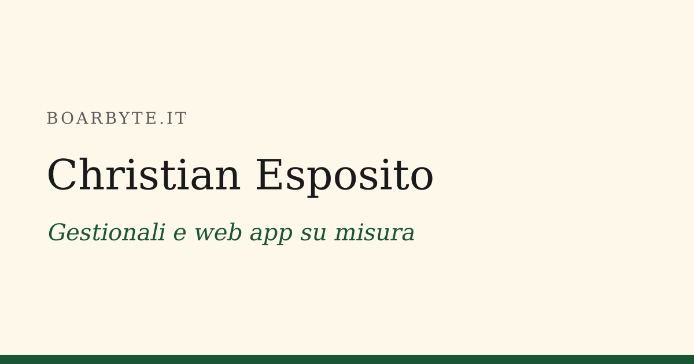

# boarbyte.it

My personal portfolio, a bilingual (Italian / English) static website: **[boarbyte.it](https://boarbyte.it)**.



It is written for two audiences. Recruiters get verifiable facts first (role, experience, stack, education, availability, downloadable CV). Small businesses get a short freelance section.

## Highlights

- **Static and fast.** Built with [Astro](https://astro.build): no database, no server-side code, no client-side framework.
- **Bilingual by design.** Every page exists at `/it/` and `/en/`, with `hreflang` alternates and a localized sitemap. The root `/` only redirects to the visitor's language.
- **Privacy-friendly.** Self-hosted fonts, no cookies, no analytics, no inline scripts, served with a Content Security Policy that only allows same-origin scripts.
- **Accessible.** Semantic markup, skip link, visible focus styles, and a palette chosen for WCAG AA text contrast.
- **Checked on every build.** `scripts/check-dist.mjs` inspects the generated HTML and fails the build on:
  - broken internal links and anchors
  - pages missing in one of the two languages
  - missing or wrong SEO / localization metadata
  - empty links and inline scripts
- **Reproducible deploy.** Every push to `master` goes live through GitHub Actions. A multi-stage Docker image runs tests and the build, then serves the result with nginx (read-only container, security headers). If a check fails, no image is produced and the live site stays as it is.

## Tech stack

Astro · TypeScript · Content Collections · Vitest · sharp · Docker · nginx · GitHub Actions

## Getting started

Requires Node.js 24 (the version used in the Docker image).

```bash
npm install
npm run dev        # dev server at http://localhost:4321
```

| Command | What it does |
| --- | --- |
| `npm run dev` | Start the dev server |
| `npm test` | Run the unit tests (Vitest) |
| `npm run build` | Type-check, build to `dist/`, then run the output checks |
| `npm run preview` | Serve the production build locally |
| `npm run images` | Generate placeholder images (social preview, case study covers) from the CSS color tokens; add `-- --force` to regenerate existing files |

## Project structure

```
src/
  config.ts           Site name, URL, contact details, profile links, stack
  i18n/               UI strings (it.json, en.json) and language helpers
  content/projects/   Case studies in Markdown, one file per language
  components/         Page sections (Hero, Experience, Projects, Freelance, Contact...)
  layouts/            Base page layout and case study layout
  pages/              Routes: /[lang]/, /[lang]/progetti/[slug]/, 404
  styles/global.css   Design tokens and global styles
scripts/              Build-time output checks and image generation
tests/                Unit tests
deploy/               Production compose file, nginx config, smoke test
```

### Adding a case study

Create `src/content/projects/it/<slug>.md` and `src/content/projects/en/<slug>.md` with the same slug:

```markdown
---
title: Project title
summary: One-line summary shown on the card.
stack: [Astro, TypeScript]
cover: ../../../assets/projects/<slug>.png
coverAlt: Description of the cover image
order: 3
github: https://github.com/...   # optional
demo: https://...                # optional
---

## The problem
...
```

The schema is validated at build time, and the output checks fail if one of the two languages is missing.

## Deployment

Every push to `master` deploys the site with GitHub Actions ([`deploy.yml`](.github/workflows/deploy.yml)):

1. Build an ARM image for the Oracle Cloud server. The Dockerfile runs the tests, the build and the output checks, so a failing check means no image and no deploy.
2. Push it to GitHub Container Registry, tagged `latest` and with the commit SHA.
3. Over SSH, pull the new image on the server, restart the container and wait until its health check passes.

On the server the container exposes no ports: Nginx Proxy Manager reaches it over a shared Docker network and handles HTTPS.

See [`deploy/README.md`](deploy/README.md) for the one-time setup and rollbacks (in Italian).

## License

The source code is released under the [MIT License](LICENSE).

The "Boarbyte" name, the boar logo and the site's personal content (texts, CV, images) are **not** covered by the MIT License: all rights reserved. If you fork this project, please replace them with your own.
